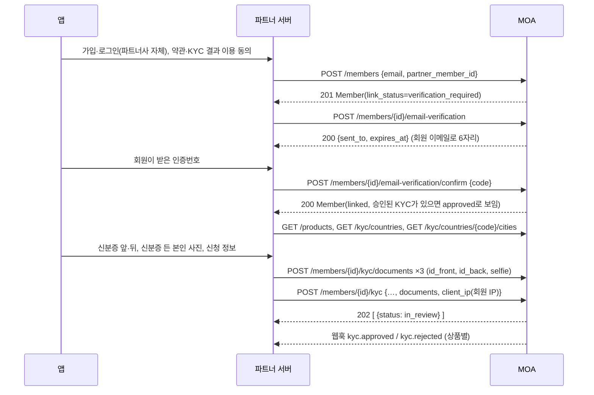
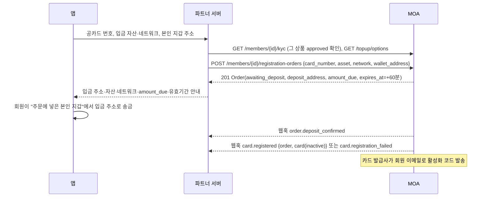
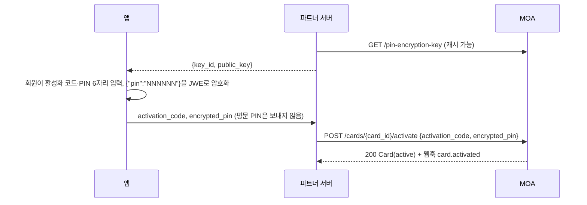
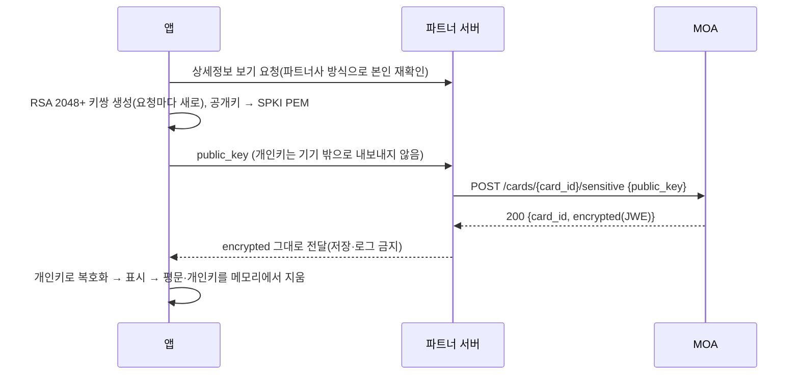
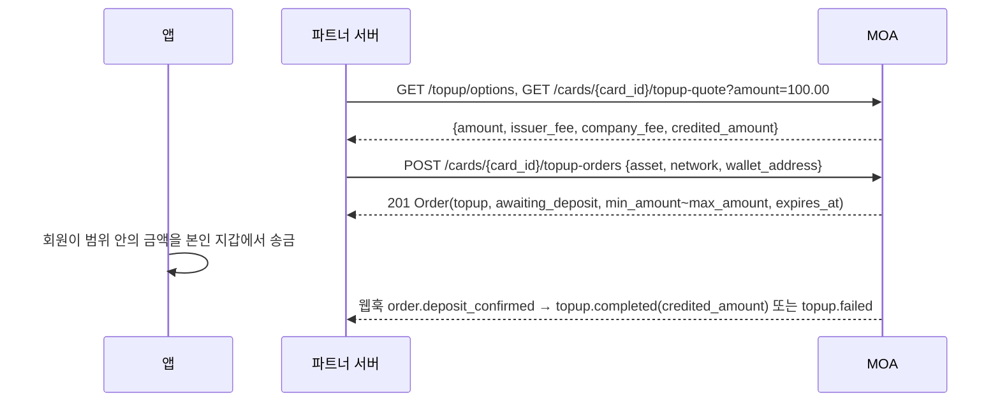

# 전체 흐름(시퀀스)

등장 주체: **앱**(회원 기기) · **파트너 서버**(비밀키 보유, MOA 호출) · **MOA**(파트너 API, 웹훅 발송). 앱은 MOA를 직접 부르지 않는다.

## 0. 연동 순서 체크리스트

| 순서 | 할 일 | 확인 |
|---|---|---|
| 1 | 회사 담당자에게 테스트 키·허용 IP·웹훅 주소 등록 요청 | 키 ID `pk_test_…`, 비밀키 `sk_test_…`(한 번만 전달), 웹훅 서명 키 `whsec_…` 수령 |
| 2 | 서명 함수 구현 | `auth-and-signing.md` 3절 고정값과 같은 서명 |
| 3 | 연결 확인 | `GET /ping` 200, `environment: test` |
| 4 | 웹훅 수신부 | 회사에 테스트 전송(`ping`) 요청 → 서명 검증·2xx |
| 5 | 회원 등록 → 이메일 인증 → KYC | 1절, 테스트 KYC 결과 API |
| 6 | 공카드 등록 → 입금 → 활성화 | 2·3절, 테스트 입금, 활성화 코드 `123456` |
| 7 | 카드 조회·관리, 충전, 거래 내역 | 4~8절 |
| 8 | 오류·재시도 | 10절 |
| 9 | 시나리오 점검 | `test-environment.md` 시나리오 전체 |
| 10 | 운영 전환(운영 오픈 공지 뒤) | 운영 키·운영 허용 IP·운영 웹훅 주소·운영 웹훅 서명 키를 따로 받고, 테스트 전용 API 호출을 운영 경로에서 뺀다 |

## 1. 회원 온보딩: 등록 → 이메일 인증 → KYC → 승인



규칙:
- **모든 회원은 이메일 인증(confirm)을 마쳐야** KYC 신청·공카드 등록 신청을 할 수 있다(기존 이용자 여부와 무관). 인증 전에는 KYC가 모두 `not_submitted`로 보이고, 신청하면 `409 member_verification_required`.
- `POST /members`의 응답은 기존 이메일이든 새 이메일이든 같다. 인증 뒤에 같은 이메일의 승인된 KYC가 보이면 KYC를 건너뛰고 공카드 등록으로 간다.
- KYC 신청 전에 `GET /members/{id}/kyc`를 보고 분기한다: 모두 `approved` → 등록으로, `pending`/`in_review` 있음 → 기다림, `not_submitted`/`rejected` → 신청·재신청.
- 신분증 이름은 영문 대문자(`GILDONG`), 전화번호는 국가 번호와 번호를 나눈다(`82`, `1012345678`). `address.city`는 도시 API의 코드 그대로.
- 거절되면 `reject_reason`을 안내하고 서류를 다시 등록해 같은 경로로 재신청한다. `422 id_document_already_used`는 다른 종류의 신분증으로 안내.
- 서류 이미지·개인정보는 회원 동의를 받고 관련 법령에 따라 처리한다.

## 2. 공카드 등록: 주문 → 입금 → 등록(inactive)



입금 처리 규칙:
- 주문의 `wallet_address`에서 `deposit_address`로, 주문과 같은 자산·네트워크로 보낸 입금만 그 주문으로 처리한다.
- 입금액이 `amount_due` 이상 `max_amount` 이하이면 카드를 등록한다. **카드 잔액 = 입금액(센트 half-up 반올림) − 등록 수수료**. 예: 125.50 입금, 수수료 20.00 → 105.50.
- 자산은 스테이블코인, 1개 = 1 USD.
- 예외 입금(자동 처리 안 함): 다른 주소(거래소 출금 포함)에서 보냄, 취소·만료 뒤 도착, `amount_due` 미만·`max_amount` 초과, 다른 자산·네트워크·입금 주소. 반환 여부·수수료·절차는 양사가 별도로 정한다. 회원에게 **거래소에서 바로 출금하지 말고 주문에 넣은 본인 지갑에서 보내도록** 안내한다.
- 유효기간 60분 안에 입금이 확인되지 않으면 주문은 자동 `cancelled`(`cancel_reason: expired`). **만료 취소는 웹훅을 보내지 않는다** → `expires_at`이 지나면 주문을 조회해 상태를 확인한다.
- 회원별 진행 중 주문은 등록·충전 합쳐 1건. 다시 시작하려면 기존 주문을 취소(`POST /registration-orders/{id}/cancel`)하거나 끝나기를 기다린다.
- `409 wallet_address_in_use`: 같은 지갑으로 입금을 기다리는 다른 주문이 있다 → 다른 지갑을 쓰거나 그 주문이 끝난 뒤 다시.

## 3. 카드 활성화(PIN은 회원 기기에서 JWE로)



PIN 암호화 규칙:
- 평문 `{"pin":"123456"}`(숫자 6자리 **문자열**). 헤더 `alg: RSA-OAEP-256`, `enc: A256GCM`, `kid: <key_id>`. 압축(`zip`) 없음. JWE compact.
- `kid`가 있으면 현재 `key_id`와 같아야 한다(다르면 `422 pin_invalid`). 공개키는 캐시해도 되지만 `key_id`가 바뀌면 다시 받는다.
- 다른 알고리즘·압축·6자리 숫자가 아닌 PIN은 모두 `422 pin_invalid`. 서버는 `encrypted_pin`을 먼저 확인하고 그다음 활성화 코드를 본다.
- 파트너 서버는 PIN을 볼 수 없고, `encrypted_pin`도 저장·로그하지 않는다.
- 활성화 코드는 카드당 24시간에 5번까지(다섯 번째 오류 `422 verification_locked`).

JavaScript(브라우저·React Native, `jose` 6.x) — `scripts/jwe_pin.mjs`의 `encryptPin`과 같다:

```javascript
import * as jose from 'jose';

/** pinKey = GET /pin-encryption-key 의 data. 반환값을 encrypted_pin 으로 보낸다 */
export async function encryptPin(pin, pinKey) {
  if (!/^\d{6}$/.test(pin)) throw new Error('PIN은 숫자 6자리여야 합니다');
  const publicKey = await jose.importSPKI(pinKey.public_key, 'RSA-OAEP-256');
  return new jose.CompactEncrypt(new TextEncoder().encode(JSON.stringify({ pin })))
    .setProtectedHeader({ alg: 'RSA-OAEP-256', enc: 'A256GCM', kid: pinKey.key_id })
    .encrypt(publicKey);
}
```

Android(Kotlin, Nimbus JOSE+JWT `com.nimbusds:nimbus-jose-jwt`):

```kotlin
import com.nimbusds.jose.*
import com.nimbusds.jose.crypto.RSAEncrypter
import java.security.KeyFactory
import java.security.interfaces.RSAPublicKey
import java.security.spec.X509EncodedKeySpec
import java.util.Base64

fun pemToRsaPublicKey(pem: String): RSAPublicKey {
    val body = pem.replace("-----BEGIN PUBLIC KEY-----", "").replace("-----END PUBLIC KEY-----", "")
    val der = Base64.getMimeDecoder().decode(body)
    return KeyFactory.getInstance("RSA").generatePublic(X509EncodedKeySpec(der)) as RSAPublicKey
}

fun encryptPin(pin: String, keyId: String, publicKeyPem: String): String {
    require(Regex("^\\d{6}$").matches(pin)) { "PIN은 숫자 6자리" }
    val header = JWEHeader.Builder(JWEAlgorithm.RSA_OAEP_256, EncryptionMethod.A256GCM).keyID(keyId).build()
    val jwe = JWEObject(header, Payload("{\"pin\":\"$pin\"}"))
    jwe.encrypt(RSAEncrypter(pemToRsaPublicKey(publicKeyPem)))
    return jwe.serialize()
}
```

iOS(Swift, JOSESwift):

```swift
import JOSESwift

func encryptPin(_ pin: String, keyId: String, publicKey: SecKey) throws -> String {
    var header = JWEHeader(keyManagementAlgorithm: .RSAOAEP256, contentEncryptionAlgorithm: .A256GCM)
    header.kid = keyId
    let payload = Payload(try JSONSerialization.data(withJSONObject: ["pin": pin]))
    guard let encrypter = Encrypter(keyManagementAlgorithm: .RSAOAEP256, contentEncryptionAlgorithm: .A256GCM, encryptionKey: publicKey) else {
        throw NSError(domain: "PinEncryption", code: 1)
    }
    return try JWE(header: header, payload: payload, encrypter: encrypter).compactSerializedString
}
```

- iOS의 `SecKeyCreateWithData`가 SPKI를 받지 않는 버전에서는 SPKI 헤더를 떼고 PKCS#1 부분만 넘긴다.
- 라이브러리 버전에 따라 이름이 조금 다를 수 있다. 테스트 환경에서 활성화(테스트 코드 `123456`)가 성공하는지 확인한다.

## 4. 카드 상세정보(카드번호·유효기간·CVV)



```javascript
import * as jose from 'jose';

// 기기에서 키쌍을 만들고 공개키를 SPKI PEM으로 내보낸다
export async function createDeviceKey() {
  const { publicKey, privateKey } = await jose.generateKeyPair('RSA-OAEP-256', { modulusLength: 2048 });
  return { privateKey, publicKeyPem: await jose.exportSPKI(publicKey) };
}

// 응답의 encrypted 를 기기 개인키로 복호화한다 → { pan, expiry_month, expiry_year, cvv }
export async function decryptCardDetails(encrypted, privateKey) {
  const { plaintext } = await jose.compactDecrypt(encrypted, privateKey, {
    keyManagementAlgorithms: ['RSA-OAEP-256'],
    contentEncryptionAlgorithms: ['A256GCM'],
  });
  return JSON.parse(new TextDecoder().decode(plaintext));
}
```

- Android: `KeyPairGenerator.getInstance("RSA")`(2048)의 공개키 `encoded`가 SPKI DER → base64 + PEM 머리·꼬리. 복호화는 Nimbus `JWEObject.parse(encrypted)` + `RSADecrypter(privateKey)`. Android Keystore 키는 OAEP MGF1(SHA-256) 지원을 대상 OS에서 확인.
- iOS: `SecKeyCreateRandomKey`(RSA 2048). `SecKeyCopyExternalRepresentation`의 공개키는 PKCS#1이므로 **SPKI 헤더를 붙여** PEM으로 보낸다(그대로 보내면 `422 public_key_invalid`). 복호화는 JOSESwift `Decrypter(keyManagementAlgorithm: .RSAOAEP256, contentEncryptionAlgorithm: .A256GCM, decryptionKey:)`.
- 카드별 시간당 10번(`429 rate_limited`). 카드 `active`·`frozen`만.

## 5. PIN 변경

1. 파트너사 방식으로 회원 본인 재확인.
2. `POST /cards/{card_id}/pin-verification`(본문 없음) → 회원 이메일로 6자리(10분, 테스트 `000000`). 1분 재요청 제한, 카드당 하루 5번.
3. 앱이 새 PIN을 3절과 같은 방식으로 JWE 암호화 → `POST /cards/{card_id}/pin` `{verification_code, encrypted_pin}` → `200` Card.
4. 틀린 인증번호 5번이면 24시간 잠김(`422 verification_locked`, 재요청은 `429`).

## 6. 이용 정지·해제

- `POST /cards/{card_id}/freeze`(`active` → `frozen`), `POST /cards/{card_id}/unfreeze`(`frozen` → `active`). 본문 없음.
- 웹훅 `card.status_changed`(`previous_status` 포함). 카드 발급사 차단(`blocked`)도 같은 웹훅으로 온다. `blocked`는 파트너 API로 풀 수 없다.

## 7. 충전



반영액 계산(각 수수료를 센트 단위 half-up 반올림, 0.5센트는 올림):

```text
issuer_fee      = round_half_up(amount × fees.topup.issuer_percent ÷ 100, 0.01)
company_fee     = round_half_up(amount × fees.topup.percent ÷ 100, 0.01) + fees.topup.fixed
credited_amount = round_half_up(amount, 0.01) − issuer_fee − company_fee
```

| 입금액 | issuer_fee(1.0%) | company_fee(1.5% + 0.00) | credited_amount |
|---|---|---|---|
| 100.00 | 1.00 | 1.50 | 97.50 |
| 33.33 | 0.33 (0.3333) | 0.50 (0.49995) | 32.50 |
| 125.50 | 1.26 (1.255) | 1.88 (1.8825) | 122.36 |

- 실제 반영액은 **실제 입금액**으로 같은 식을 계산하고, 요율은 **주문 생성 시점** 값(주문의 `fees`)을 쓴다.
- 충전 주문은 `amount_due`가 없다. 범위 밖 입금은 예외 입금. 반영액 0 이하 → `failed`(`amount_below_fees`) + `topup.failed`. 입금 뒤 카드가 차단·해지 → `failed`(`card_not_active`). `frozen` 카드는 충전된다.
- 충전 주문 생성은 카드 `active`에서만(아니면 `422 card_not_active`).
- 파트너사 화면에서 계산하려면 decimal 연산으로 위 식을 그대로 구현하거나, `topup-quote`를 부른다.

## 8. 거래 내역·환불 연결

- 결제·취소·환불·조정: `GET /transactions?card_id=…&type=payment,reversal,refund,adjustment`. ATM: `type=atm_withdrawal`.
- 정렬·`from`/`to`는 `created_at` 기준. 화면 표시 시각은 `occurred_at`.
- 실시간 반영은 웹훅: 승인·거절 `authorization.approved`/`authorization.declined`, 정산·환불·취소·수수료·조정 `transaction.posted`.
- 원거래 화면: 같은 카드 거래 중 `original_transaction_id`가 원거래 ID인 항목을 묶는다. 원거래 전액 승인 취소 시 원거래 `status`가 `reversed`.
- 잔액은 `GET /cards/{card_id}/balance`(Card 객체에는 없다).

## 9. 상태 동기화 전략(웹훅 + 조회)

- 웹훅을 1차 신호로 쓰고, 받은 뒤 해당 회원·카드·주문을 **조회해 최신 상태**를 저장한다(웹훅은 순서·한 번 도착을 보장하지 않는다).
- 웹훅이 오지 않는 경우: 주문 만료 취소(`expires_at` 경과 → `GET` 주문 조회), 웹훅 수신 장애(→ `GET /events?from=…`로 빠진 알림 확인, 회사에 재전송 요청).
- 폴링할 때도 요청마다 새 시각으로 서명한다(같은 서명 재사용 시 401). 레이트리밋(키별 초당 20회, IP별 초당 10회)을 지킨다.

## 10. 오류·재시도 처리

| 상황 | 처리 |
|---|---|
| 응답 없음(타임아웃·연결 끊김) | POST는 **같은 Idempotency-Key**로, GET은 그대로 다시. 모두 새 시각으로 서명 |
| `retryable: true`(`409 request_in_progress`, `429`, `500`, `503`) | `Retry-After`가 있으면 그만큼, 없으면 1초·2초·4초… 백오프 후 같은 키로 재시도 |
| `401 authentication_failed` | 재시도하지 않는다. `auth-and-signing.md` 10절 점검표 |
| `400 invalid_request` | 재시도하지 않는다. `details`로 입력을 고친 뒤 **새 키**로 |
| `409`·`422` 업무 오류 | 회원에게 `user_message`를 보여 주고, 상태를 조회해 다음 행동을 정한다(`errors.md`) |
| `502 issuer_error` | 같은 요청을 반복하지 않는다. `user_message` 안내, 계속되면 `X-Request-Id`와 함께 회사에 문의 |
| 같은 키 재전송에 `Idempotent-Replayed: true` | 처음 결과다. 회원 이메일이 든 응답이면 `data: null` → 다시 조회 |

예시 구현은 `scripts/partner_client.mjs`(새 시각 서명, 같은 키 재시도, 재시도 대상 판별, 같은 초 중복 서명 방지).
